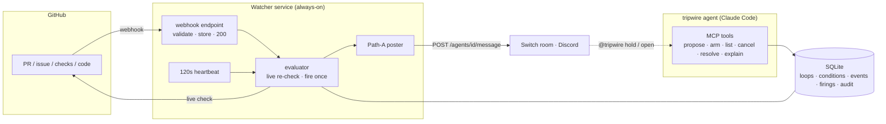

# Tripwire

**A teammate in a [Switch](https://github.com/sandbox-quantum/switch) room that holds every "not now, when X" — from a person or an agent — and wakes whoever was waiting the moment X happens, with the original reason and fresh evidence.**


Built for the **Flip the Switch** hackathon (Nov 4–7, 2026).

> **The demo moment:** one live GitHub merge reopens a paused *human* decision **and** restarts a blocked *coding agent* — in the same room, within seconds.

---

## The problem

Across **10 real team meetings** (GitLab, Rust, Kubernetes, Cloud Native Buildpacks) we counted about **25 conditional deferrals** against about **10 firm decisions**. Every deferral had an unblock condition — *"when the PR lands"*, *"once someone actually uses it"*, *"let's check back next month"* — and **nobody watched the condition**. The decision just evaporated until someone happened to remember it.

Agents have the exact same problem: they get blocked, go quiet, and nobody wakes them.

Existing tools handle either human decision-memory *or* agent waits — never both, in one shared room. Tripwire treats a person's "not now" and an agent's "I'm blocked" as the **same open loop**.

## What Tripwire does

Everything Tripwire tracks is an **open loop**: something waiting · who is waiting (a person or an agent) · the condition that unblocks it · the reason it waited · an owner · and the evidence when it fires.

A loop moves through a small state machine:

```
proposed ──arm──▶ armed ──fire──▶ fired ──resolve──▶ closed
   │                 │
 cancel           cancel/expire
   ▼                 ▼
 closed            closed
```

- **proposed** — Tripwire heard a deferral and drafted the loop.
- **armed** — a human confirmed it (an agent's own "wake me" arms itself).
- *watching* — the condition is re-checked on every matching event and on a heartbeat.
- **fired** — the condition was re-checked **live** and is true; Tripwire posts the reopen card and wakes the waiter.
- **closed** — resolved, cancelled, or expired.

**Conditions (all implemented):**

| Condition | Fires when | Example deferral |
| --- | --- | --- |
| `github.pr_merged` | a PR merges | *"Not until the design PR lands"* |
| `github.issue_closed` | an issue closes | *"Once the platform RFC is settled"* |
| `github.checks_green` | all checks on a ref pass | *"Wait for the crater run"* |
| `usage.count_at_least` | a needle appears in ≥ N files across watched repos | *"Stabilize once the ecosystem uses it"* |
| `time.after` | a date/time passes | *"We'll check back next month"* |

## How it works

Tripwire is **two processes sharing one SQLite file**. The agent handles *language*; the watcher decides *truth* with deterministic code — so nothing ever fires on a model's guess.



- **The agent** turns conversation into loops through MCP tools (`propose_loop`, `arm_loop`, `list_loops`, `explain_loop`, `cancel_loop`, `resolve_loop`). Only a human in `HUMAN_HANDLES` can arm or cancel a *decision*; agents can only propose.
- **The watcher** ingests GitHub webhooks (validate, store, return — nothing else), and on both the webhook (deviation) and a 120-second heartbeat it re-checks matching armed loops **live** before firing. It posts into the room by posting as the `tripwire` agent through the Switch agent bridge's connectionless `POST /agents/{id}/message` (**Path A**, verified against the Switch source).

**Non-negotiable invariants, enforced in code and tested:**

| | Invariant |
| --- | --- |
| **I1** | Fire **at most once** per loop — a `UNIQUE` firing row, not hopeful application logic (proven under two concurrent connections). |
| **I2** | **Never fire on unobserved data.** A source that can't be reached (after 3 retries at 1s/4s/16s) is `unobserved`, never a false `false`. |
| **I3** | The webhook handler only validates, stores and returns — no GitHub calls, posts, or model work inside a request. |
| **I4** | Every fire carries **evidence** (a link + timestamp). |
| **I6** | The model handles language only; condition truth comes from deterministic code. |
| **I7** | Every state change writes an `audit` row. |

## Status — what's proven

- ✅ **End-to-end, live:** a real GitHub merge, caught by the heartbeat poll, live-re-checked, fired **exactly once**, and posted the reopen card into a Discord `#launch-room` via Path A — evidence link and all.
- ✅ **118 tests** green (`typecheck`, `test`, `lint`) — the state machine (every allowed/rejected transition), fire-once under concurrency, all five conditions (true/false/unobserved), the webhook, the evaluator, the MCP tools (driven through a real MCP client).
- 🔜 Running `tripwire`/`builder` as live Claude Code agents for the full chat-driven demo is a deployment step (see `docs/SETUP.md`).

## Running it

Node 20, TypeScript (strict), ESM.

```bash
nvm use                 # Node 20
npm install
npm run typecheck && npm test && npm run lint
```

| Script | What it does |
| --- | --- |
| `npm run dev:watcher` | the watcher service (webhook + heartbeat + poster) |
| `npm run dev:mcp` | the Tripwire MCP server (stdio) |
| `npm run seed -- <owner/repo> <pr#> "<title>"` | arm a loop watching a PR, for a live demo |
| `npm run typecheck` / `npm test` / `npm run lint` | the checks CI runs |

**See a real merge fire a card** (no public webhook needed — the heartbeat polls GitHub):

```bash
# .env with your Switch agent creds + a watched repo (see .env.example and docs/SETUP.md)
mkdir -p data
set -a; . ./.env; set +a
npm run seed -- <owner/repo> <pr-number> "pricing-page decision"
npm run dev:watcher
# merge the PR → within one heartbeat the reopen card lands in the room
```

Secrets live only in environment variables (`.env.example` ships names only); logs are redacted and never carry message bodies.

## Layout

```
src/
  core/        loop model, state machine, errors (pure)
  conditions/  one file per condition: params schema + evaluate() (pure)
  sources/     GitHub client with retries (I/O)
  store/       SQLite access, migrations
  watcher/     webhook server, evaluator loop, heartbeat, poster wiring
  room/        RoomPoster (Path A) + message renderers
  mcp/         MCP server, tools, loop-operations service
test/          vitest, mirrors src/
docs/
  context/     the spec pack (agents.md + project_overview / architecture / … / progress_tracker)
  SETUP.md     phone-followable runbook for the Switch server, Discord and agents
  agents/      paste-ready tripwire / builder agent definitions
```

The full design, the Switch research (Q1–Q6, cited to the source), and the running log live in
[`docs/context/progress_tracker.md`](docs/context/progress_tracker.md).

## Built on Switch

Any vendor's agents and the people on the team share **one waiting list**, inside the room they already work in. That's why Tripwire belongs on Switch.

---

<sub>Flip the Switch, Nov 2026.</sub>
